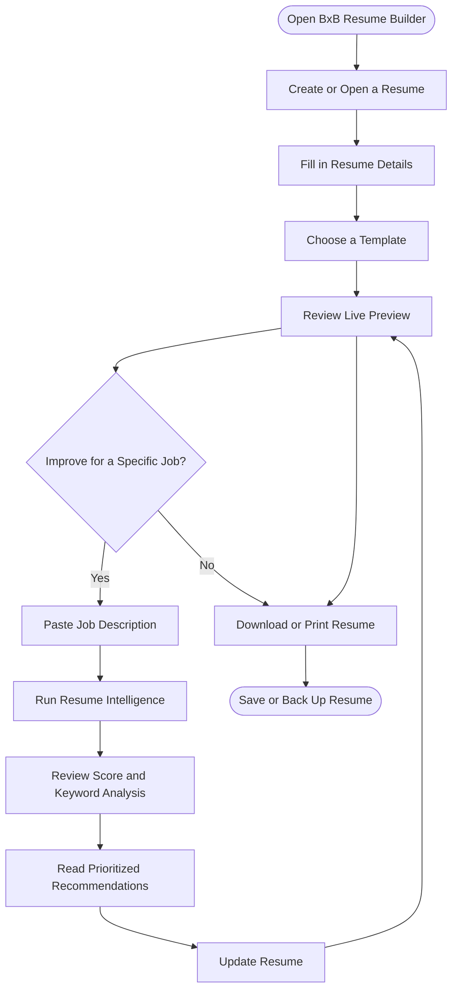
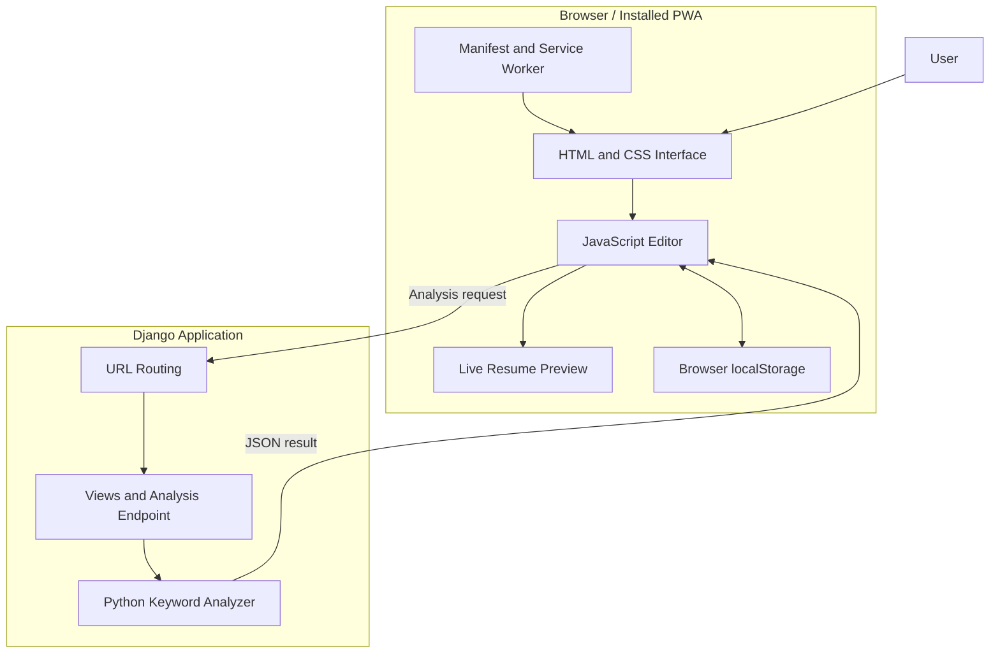

# ✨ BxB AI Resume Builder

<p align="center">
  <strong>Build your resume. Understand your strengths. Prepare for your next opportunity.</strong>
</p>

<p align="center">
  A responsive, installable resume-building web app with job-specific resume analysis and personalized improvement recommendations.
</p>

<p align="center">
  
  
  
  
</p>

<p align="center">
  
  
  
</p>

---

## 📌 Table of Contents

- [Overview](#-overview)
- [Features](#-features)
- [How It Works](#-how-it-works)
- [System Architecture](#-system-architecture)
- [Resume Intelligence](#-resume-intelligence)
- [Technology Stack](#-technology-stack)
- [Project Structure](#-project-structure)
- [Installation](#-installation-and-setup)
- [Running the Application](#-running-the-application)
- [Progressive Web App](#-progressive-web-app-pwa)
- [Privacy and Data Storage](#-privacy-and-data-storage)
- [Troubleshooting](#-troubleshooting)
- [Development Roadmap](#-development-roadmap)
- [Contributing](#-contributing)
- [License](#-license)

---

## 🚀 Overview

**BxB AI Resume Builder** is a Django-powered web application designed to help students, fresh graduates, and job seekers create professional resumes and evaluate how well their resume aligns with a particular job description.

The application combines a resume editor with a rule-based Resume Intelligence engine. Users can create multiple resumes, select a template, preview changes instantly, compare their resume against a job description, and receive prioritized suggestions for improvement.

The project is designed around a local-first experience: resume drafts can remain in the user's browser without requiring an account or a cloud resume database.

### 🎯 Project Goals

- Simplify resume creation for students and early-career professionals.
- Provide multiple professional resume layouts.
- Help users identify relevant skills and experience gaps for specific roles.
- Provide transparent, explainable resume compatibility estimates.
- Support installation as a Progressive Web App.
- Keep the core resume editor functional without a third-party AI API.

> **Important scoring notice:** The score produced by Resume Intelligence is an estimated, job-specific keyword compatibility indicator. It is not a score from an employer's Applicant Tracking System (ATS) and does not predict shortlisting, hiring, or interview selection.

---

## 🌟 Features

### 📝 1. Resume Editor

Create and update your resume using a live editor.

- Live preview as users edit their details.
- Personal information and professional summary.
- Education history.
- Technical and professional skills.
- Projects and project descriptions.
- Work experience, internships, and relevant roles.
- Certifications and achievements.
- Browser print and Save as PDF support.

### 🎨 2. Resume Templates

Choose from three resume layouts:

| Template | Best suited for |
|---|---|
| **ATS-first** | Clean, conventional resumes with straightforward formatting |
| **Modern Professional** | Contemporary professional applications |
| **Academic / Research** | Academic profiles, research applications, and education-focused resumes |

The available templates can be selected from the editor or resume library, depending on the current UI version.

### 📚 3. Resume Library

Manage different resumes for different opportunities.

- Create multiple named resumes.
- Open and switch between saved drafts.
- Rename resumes.
- Delete resumes.
- Autosave edits in browser storage.
- Export and import JSON backups, where enabled.
- Back up the resume library, where enabled.

### 🧠 4. BxB Resume Intelligence

Compare a resume with a supplied job description.

The analysis can identify:

- Keywords matched in substantive resume sections.
- Skills that appear in the resume but need stronger evidence.
- Recognized job-description keywords missing from the resume.
- Category-specific recommendations.
- Prioritized improvements for the target role.
- An estimated compatibility score and its rating category.

### 🌗 5. Light and Dark Themes

The interface supports light and dark appearances in the editor version where theme switching is integrated.

### 📱 6. Responsive Web Experience

The interface is designed to adapt to:

- Desktop screens.
- Tablets.
- Mobile phones.
- Narrow browser windows.

### 📲 7. Progressive Web App

The PWA integration is intended to support:

- Installation from compatible browsers.
- A home-screen or desktop app icon.
- Standalone app-window display.
- Static asset caching.
- An offline fallback page.

Actual installation and offline behavior depend on the configured files, deployment environment, and browser support.

---

## 🔄 How It Works

The normal user journey is:



### Typical workflow

1. Open the application.
2. Create a new resume or select an existing one.
3. Enter personal, academic, and professional details.
4. Select the preferred resume template.
5. Paste a target job description into Resume Intelligence.
6. Analyze the resume and review the score.
7. Improve relevant descriptions and address genuine skill gaps.
8. Download or print the resume.
9. Export a backup when the relevant feature is available.

---

## 🏗️ System Architecture

The application uses Django for server-side page rendering and resume analysis, while the browser handles the editor interface, live preview, and local drafts.



### Architecture responsibilities

| Component | Responsibility |
|---|---|
| Django templates | Render the home page and resume editor |
| HTML and CSS | Define forms, templates, themes, and responsive layout |
| JavaScript editor | Handle field updates, repeatable sections, draft management, and live preview |
| `localStorage` | Keep supported resume drafts in the current browser |
| Django views | Serve pages and handle analysis requests |
| `ats_analyzer.py` | Recognize job keywords and calculate the compatibility estimate |
| `ats_analyzer.js` | Submit analysis requests and display results |
| Web app manifest | Define the installable application's metadata |
| Service worker | Manage eligible cached resources and offline fallback behavior |

The diagram describes the intended integration. Confirm the actual paths and endpoints in the repository before deployment.

---

## 📊 Resume Intelligence

Resume Intelligence uses a Python rule-based keyword analyzer. It does not require a third-party LLM or AI API key.

### Analysis categories

| Result | Meaning |
|---|---|
| **Matched with evidence** | A recognized keyword appears in a substantive resume section |
| **Needs stronger evidence** | A recognized keyword appears in the resume but was not found in the main evidence sections |
| **Missing** | A recognized job-description keyword was not detected in the resume |

These classifications indicate where text was found. They do not independently verify that a candidate possesses the skill.

### Estimated score methodology

The current rule-based scoring approach uses three contribution weights:

| Evidence category | Weight |
|---|---:|
| Matched with evidence | 100% |
| Needs stronger evidence | 40% |
| Missing keyword | 0% |

The estimate is calculated from the recognized keywords in the supplied job description:

```text
Estimated score =
    (Matched count × 1.0
     + Needs-evidence count × 0.4
     + Missing count × 0.0)
    ÷ Total recognized keywords
    × 100
```

The resulting score is rounded to an integer between 0 and 100.

### Score rating categories

| Estimated score | Rating |
|---:|---|
| 0–24 | Bad |
| 25–39 | Moderate |
| 40–54 | Needs a Little Improvement |
| 55–69 | Good |
| 70–79 | Strong |
| 80–89 | Great |
| 90–100 | Top Level |

These are BxB's own heuristic rating bands, not industry-standard ATS thresholds.

### Recommendation priorities

The analyzer